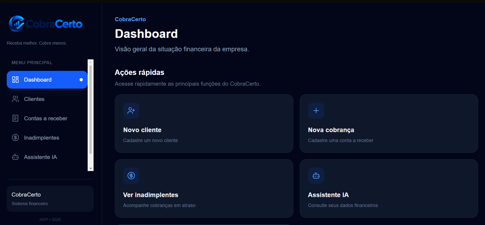
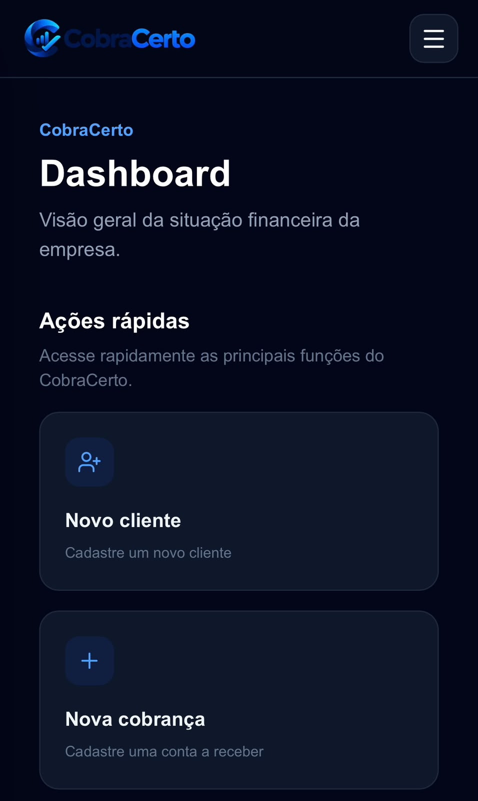

# 🐍 CobraCerto

> **Receba melhor. Cobre menos.**

O **CobraCerto** é uma plataforma SaaS de gestão de cobranças e recebimentos voltada para pequenas e médias empresas.

A aplicação centraliza clientes, contas a receber, inadimplência, conciliação bancária e indicadores financeiros, além de utilizar **Inteligência Artificial com Google Gemini** para geração de mensagens de cobrança e análise financeira.

---

## 🌐 Aplicação online

**Frontend**

https://frontend-production-4dea.up.railway.app

**Backend / API**

https://backend-production-1a9d.up.railway.app

**Swagger**

https://backend-production-1a9d.up.railway.app/docs

---

## 📸 Preview

### Desktop



### Mobile

<p align="center">
  
</p>

---

## 🎯 Problema

Muitas pequenas e médias empresas ainda realizam o controle de cobranças e pagamentos utilizando planilhas, mensagens manuais e processos separados.

Isso pode gerar:

- cobranças esquecidas;
- aumento da inadimplência;
- dificuldade para identificar clientes em atraso;
- perda de tempo com tarefas financeiras manuais;
- dificuldade na conciliação de pagamentos;
- pouca visibilidade sobre a situação financeira da empresa.

---

## 💡 Solução

O CobraCerto centraliza o processo de cobrança em uma única plataforma.

A empresa consegue acompanhar seus clientes, registrar contas a receber, identificar inadimplentes, gerar mensagens de cobrança com IA, realizar conciliação bancária e consultar seus indicadores financeiros através de um dashboard.

---

## 🚀 Principais funcionalidades

### 👥 Gestão de clientes

- Cadastro de clientes
- Consulta de clientes
- Telefone, e-mail e documento
- Validação de registros duplicados

### 💰 Contas a receber

- Cadastro de cobranças
- Valor da cobrança
- Data de vencimento
- Status automático
- Identificação de cobranças pendentes
- Identificação de cobranças vencidas
- Marcação de pagamento

### ⚠️ Controle de inadimplência

O sistema identifica automaticamente cobranças vencidas e apresenta informações como:

- cliente responsável;
- valor em atraso;
- data de vencimento;
- quantidade de dias em atraso;
- situação da cobrança.

### 🤖 Cobranças com Inteligência Artificial

O CobraCerto utiliza a API do **Google Gemini** para gerar mensagens de cobrança baseadas nos dados reais registrados no sistema.

O usuário pode escolher diferentes tons:

- amigável;
- profissional;
- formal;
- direto.

A aplicação possui fallback para garantir que a cobrança continue funcionando mesmo em caso de indisponibilidade temporária do serviço de IA.

### 📱 Integração com WhatsApp

Após gerar a mensagem, o sistema permite abrir o WhatsApp com:

- telefone do cliente;
- mensagem de cobrança previamente preenchida.

### 📊 Dashboard financeiro

O dashboard apresenta uma visão geral da situação financeira da empresa, incluindo:

- total a receber;
- total recebido;
- total vencido;
- quantidade de cobranças;
- taxa de inadimplência;
- distribuição das cobranças por status.

Também possui ações rápidas para acesso às principais funcionalidades.

### 📈 Analytics

O sistema utiliza **Recharts** para apresentar informações financeiras de forma visual.

Os gráficos permitem acompanhar cobranças:

- pagas;
- pendentes;
- vencidas.

### 🏦 Conciliação bancária por CSV

O usuário pode importar um extrato bancário no formato CSV.

O CobraCerto analisa as transações e procura cobranças correspondentes.

Fluxo:

1. Upload do arquivo CSV
2. Análise das transações
3. Identificação de possíveis correspondências
4. Exibição das transações encontradas e não encontradas
5. Confirmação da conciliação
6. Atualização das cobranças conciliadas como pagas

### 🧠 Assistente Financeiro com IA

O CobraCerto possui um assistente financeiro conectado aos dados reais armazenados no PostgreSQL.

Exemplos de perguntas:

- Quanto eu já recebi?
- Quanto tenho em atraso?
- Quantas cobranças foram pagas?
- Qual é minha taxa de inadimplência?
- Quais cobranças precisam de mais atenção?

---

## 🛠️ Tecnologias

### Frontend

- Next.js
- TypeScript
- Tailwind CSS
- Recharts
- Lucide React

### Backend

- Python
- FastAPI
- SQLAlchemy
- Pydantic

### Banco de dados

- PostgreSQL

### Inteligência Artificial

- Google Gemini API

### Infraestrutura

- Docker
- Docker Compose
- Railway

### Versionamento

- Git
- GitHub
- Git Flow
- Pull Requests

---

## 🏗️ Arquitetura

```text
                    ┌─────────────────┐
                    │     Usuário     │
                    └────────┬────────┘
                             │
                             ▼
                    ┌─────────────────┐
                    │     Next.js     │
                    │    Frontend     │
                    └────────┬────────┘
                             │
                             ▼
                    ┌─────────────────┐
                    │     FastAPI     │
                    │     Backend     │
                    └───────┬─┬───────┘
                            │ │
                ┌───────────┘ └───────────┐
                ▼                         ▼
        ┌───────────────┐         ┌───────────────┐
        │  PostgreSQL   │         │  Gemini API   │
        │ Banco de dados│         │      IA       │
        └───────────────┘         └───────────────┘